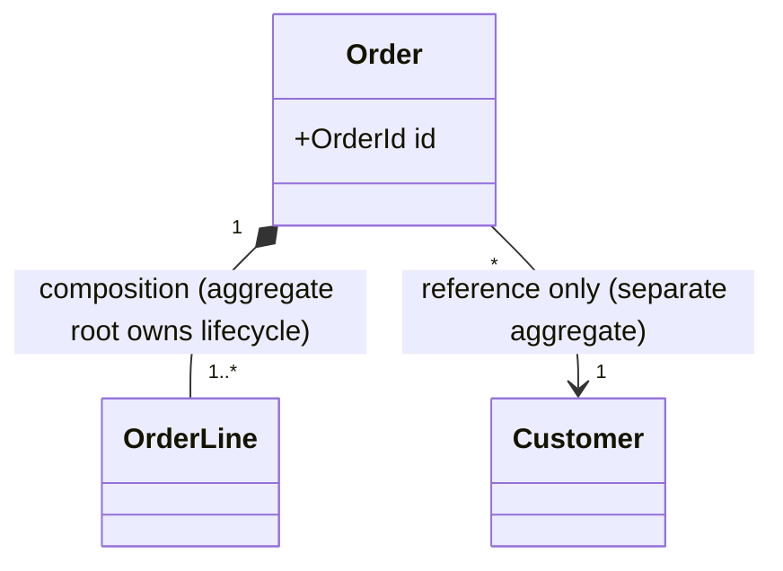

# uneri-skills:sdd-design — produce technical design from approved requirements

## Overview

Reads the approved `requirements.md` and the clarifications recorded by `/uneri-skills:sdd-clarify`,
consults project steering docs and referenced design docs (reference, do not duplicate), and
writes `.kiro/specs/<slug>/design.md`. Always includes a **Boundary Commitments** section that
makes the in-scope / out-of-boundary line explicit. **Local-only** — no `gh`, no MCP.

## Gate (hard rule — check first, both conditions required)

**REFUSE to proceed** unless `.kiro/specs/<slug>/spec.json` satisfies **both**:

1. `approvals.requirements.approved == true`
2. `phase == "clarified"`

If either condition is missing, report the specific failure and the fix:

| Missing condition                          | Error message                                                                                                                                                                                                                                |
| ------------------------------------------ | -------------------------------------------------------------------------------------------------------------------------------------------------------------------------------------------------------------------------------------------- |
| `approvals.requirements.approved` is false | **Error:** Requirements have not been approved yet. Approve the existing requirements (set `approvals.requirements.approved: true` after review), or run `/uneri-skills:sdd-requirements` first if requirements have not been generated yet. |
| `phase` is not `"clarified"`               | **Error:** Clarification has not been completed yet. Run `/uneri-skills:sdd-clarify` first to resolve open questions and advance the phase.                                                                                                  |

Do not ask any questions, do not write any file, and do not continue until **both** conditions are satisfied.

**Re-open exception (review-driven redesign).** When the design was already generated/approved (`phase` is
`design-generated` / `tasks-generated` / `implemented`) and a later **acceptance review** found the
**design itself** wrong or the intent uncaptured — while the requirements/acceptance criteria remain correct —
re-running this skill **is allowed** as long as `approvals.requirements.approved == true` — the
`phase == "clarified"` condition is waived **only for this explicit re-open**. Re-opening is not free: it
**resets downstream approvals** (see Steps) so the revised design must be re-approved and tasks regenerated
with fresh PL sign-off.

This is one of **three re-open paths**, chosen by where the review found the defect (all gated on the same
"did the UC's goal change" test, not on whether *something* changed):

| The defect is in…                                                  | Re-open with              | What resets                                                                                              |
| ------------------------------------------------------------------ | ------------------------- | -------------------------------------------------------------------------------------------------------- |
| The design (requirements still correct)                            | `sdd-design` (this skill) | `approvals.design.*`, `approvals.tasks.*`, `ready_for_implementation`                                    |
| A clarification answer (requirements' EARS criteria still correct) | `sdd-clarify`             | same as above                                                                                            |
| The requirements' acceptance criteria themselves                   | `sdd-requirements`        | `approvals.requirements.approved`, `approvals.design.*`, `approvals.tasks.*`, `ready_for_implementation` |

Specs are living documents — a refined or corrected acceptance criterion is not by itself a reason to avoid
reusing the spec via one of these three paths. Only if the **UC's goal itself changed** (see
`uneri-skills:udd-authoring` § Re-work vs goal change) do **not** re-open this spec at all — spin a **new UC + new
spec** and mark the old UC `deprecated` + `superseded_by`. The test is whether the UC's goal/scope changed,
not whether any single acceptance criterion was edited.

## Language

Read language from `spec.json` → `language`. If absent, fall back to `.uneri.json` → `lang`, then
default `en`. This skill takes **no `--lang`** — language is already resolved and stored in
`spec.json` by `/uneri-skills:sdd-init`.

## Steps

1. **Read `spec.json`** from `.kiro/specs/<slug>/`. Check both gate conditions (above). Note the
   `language` field.

2. **Read `requirements.md`** from `.kiro/specs/<slug>/requirements.md`, including the
   `## Clarifications` section appended by `/uneri-skills:sdd-clarify`.

3. **Consult project steering and design docs** — read only what this UC needs. Typical sources:

   - `.kiro/steering/` — structure, context map, technical decisions.
   - `.kiro/uneri/domain-model.md`, `actors.md`, `glossary.md`.
   - Any referenced design docs the UC touches (e.g. API spec, data model, ADR).

   **Reference these docs; do not duplicate their content** in `design.md`. Cite the relevant
   sections by file and heading instead.

4. **Write `design.md`** at `.kiro/specs/<slug>/design.md` following the skeleton below.
   The **Boundary Commitments** section is **mandatory** — hard-fail if omitted. The **minimum
   baseline sections** (Architecture, API design, Data model / DB, Domain model, Components,
   Sequence) are also **required** — but each may be a one-line **"No change — see `<SoT doc>`"**
   when the slice adds nothing to that layer (keep "reference, do not duplicate"). Never silently
   omit a section; an omission reads as "not considered".

5. **Update `spec.json`**:
   - Set `phase: "design-generated"`.
   - Set `approvals.design.generated: true`.
   - **On a re-open (review-driven redesign): also reset downstream approvals** so nothing stays approved on top of a
     changed design — set `approvals.design.approved: false`, `approvals.tasks.generated: false`,
     `approvals.tasks.approved: false`, and `ready_for_implementation: false`. The PL must re-approve the revised design
     and `/uneri-skills:sdd-tasks` must regenerate tasks.
   - Refresh `updated_at` to the current ISO-8601 timestamp.

6. **Record the open decisions, and show them before asking for review.** An open decision is a place where the design
   leaves a real choice unmade: alternatives named but none chosen, a `TBD`, or an assumption nobody confirmed. Write them
   in the `## Decisions` section of `design.md`, one row each with the options, a recommendation and a status (`open` or
   `settled`), so the record outlives the conversation. Show the same list to the user and settle each with them. If none is
   open, write "No open decisions." in that section and say so in one line. A design that goes to tasks with an open decision
   comes back as rework, so do **not** set `approvals.design.approved: true` while one is `open`.
   - **Exception: the user delegates.** If the user explicitly tells you to decide and approve without review, settle each
     decision yourself, mark it `settled` with a line saying the user delegated it and the date, and tell the user which
     decisions you made, in your reply and in `design.md`. Point out the ones that are product decisions rather than
     technical ones. The approval is then the user's; the decisions stay visible.
   - A settled decision that passes the *Spec or ADR?* test (in `/uneri-skills:adr`'s authoring reference) is offered to
     `/uneri-skills:adr draft spec:{feature}` at this point, so the user sees it while reviewing. Do not write an ADR
     unasked. Most decisions stay in `design.md`.

7. **Ask the user to review** the generated `design.md`. When they confirm the design is correct:
   - Set `approvals.design.approved: true` in `spec.json`.
   - Refresh `updated_at`.
   - Point to the next step: optionally `/uneri-skills:sdd-validate-design` to review design
     quality first, then `/uneri-skills:sdd-tasks`.

## The `design.md` it writes

Write this file at `.kiro/specs/<slug>/design.md`. Substitute real values for `<feature>` and the
UC reference. Localize headings and prose to `spec.json.language`:

> **Minimum baseline sections (do not silently omit).** Every design MUST contain the sections
> below. The four "layer" sections (Architecture, API, Data/DB, Domain model) and the sequence
> **must still respect "reference, do not duplicate"**: when a slice adds nothing to a layer, keep
> the section but write a one-liner **"No change — see `<SoT doc>`"** (e.g. `No change — reads the
> existing`tenants`table, see database.md`). A missing section reads as "not considered"; an
> explicit "No change — see X" reads as "considered, nothing to add". Diagrams use **mermaid**
> fenced blocks. Keep them minimal — a read-only slice needs one small sequence, not an essay.

### Diagram conventions (mermaid) — make the diagram carry the design intent

The diagram's job is to **communicate intent to a reviewer**, not to prove UML conformance. Use
**mermaid** (renders natively on GitHub, stays diffable, local-only — the same reasons the whole
plugin keeps design in the repo). Pick the diagram type that matches the section, and use the
**notation that carries meaning** — an unlabelled box-and-arrow sketch conveys almost nothing.

| Section                     | Diagram type      | Notation that must carry intent                                                                                                                                                                                                                 |
| --------------------------- | ----------------- | ----------------------------------------------------------------------------------------------------------------------------------------------------------------------------------------------------------------------------------------------- |
| Architecture (components)   | `flowchart`       | Layer/direction of dependency; label each edge (call / event / read)                                                                                                                                                                            |
| Data model / DB             | `erDiagram`       | Entities, PK/FK, **cardinality** (`\|\|--o{`)                                                                                                                                                                                                   |
| Domain model                | `classDiagram`    | **Relationship kind** — composition `*--`, aggregation `o--`, inheritance `<\|--`, dependency `..>`, realization `..\|>` — **and multiplicity** (`"1" --> "*"`). This is where aggregate boundaries live; a prose-only domain model hides them. |
| State-bearing aggregate     | `stateDiagram-v2` | States + transition triggers (add this when the slice introduces a lifecycle)                                                                                                                                                                   |
| Sequence (primary scenario) | `sequenceDiagram` | Lifelines, message order, and rainy-day branches via `alt` / `opt`                                                                                                                                                                              |

**The load-bearing distinction is relationship kind + multiplicity**, not arrowhead precision. Two
lines of `classDiagram` say what a paragraph cannot:



`*--` + multiplicity states that `OrderLine` lives and dies with `Order`, while `Customer` is a
cross-aggregate reference — the boundary decision a reviewer needs, invisible in prose.

- ❌ `Order --> OrderLine` (unlabelled, no multiplicity) — reads as "some association, unknown kind".
- ✅ `Order "1" *-- "1..*" OrderLine : composition` — states ownership and cardinality.

**Escape hatch — strict UML.** When a slice genuinely needs UML mermaid cannot express (e.g.
regulated detailed class design with full stereotypes), you may author it in PlantUML and commit
the **rendered SVG** next to `design.md`, referencing it from the section. Call out the trade-off
in the section: the SVG is **not diffable** and needs a render step, so use it only where mermaid
is truly insufficient — never as the default.

```markdown
# Design: <feature>

## Overview

<1–3 sentences summarising the design approach and the key decision made.>

## Decisions

<A table: ID, decision, options, recommendation or rationale, status (`open` | `settled`). `settled` rows that the
user delegated say so, with the date. With nothing to decide, write "No open decisions.">

## Architecture (components)

<A mermaid `flowchart` of the components/layers this slice touches (frontend → API → use_case →
repository → store, or the equivalent for this project). Reference existing architecture docs by
file/heading; do not duplicate. New layers only.>

## API design

<New/changed endpoints only: method + path, auth, request, response shape, status codes. The
canonical API spec (e.g. openapi.yaml / api-authz.md) stays the SoT — cite it. If this slice
changes no API, write "No change — see <api doc>".>

## Data model / DB

<New tables/columns/indexes/migrations only, as a mermaid `erDiagram` with PK/FK and cardinality
when relationships are added. If the slice only reads or adds nothing, write "No change — see
<db doc>" and name the table(s) read. Never restate the whole schema.>

## Domain model

<New aggregates / commands / events only, as a mermaid `classDiagram` — use relationship kind
(composition `*--` / aggregation `o--` / inheritance `<|--`) and multiplicity to make aggregate
boundaries explicit (cite domain-model.md by name). Add a `stateDiagram-v2` when the slice
introduces a lifecycle. A read/query slice that introduces none writes "No change — reads AGG-… ;
see domain-model.md".>

## Components

<Implementation units at file granularity (modules/files to add or change), each with its one-line
responsibility. This is the "where the code goes" list.>

## Sequence (primary scenario)

<A mermaid `sequenceDiagram` for the primary flow, with key rainy-day branches (e.g. auth denied /
not found) expressed via `alt` / `opt`. Reference domain-model.md aggregates and events by name;
do not redefine.>

## Boundary Commitments

### In scope

- <Concrete deliverable or behaviour this spec will implement.>
- <…>

### Out of boundary

- <Related concern that is explicitly NOT part of this spec.>
- <…>

## Error handling

<Describe how each rainy-day requirement from requirements.md is handled at the design level.
Reference requirement numbers (e.g. 1.2, 1.3) for traceability.>
```

## Common mistakes (do NOT repeat)

| ❌ Mistake                                                       | ✅ Correct                                                                                                                                                   |
| ---------------------------------------------------------------- | ------------------------------------------------------------------------------------------------------------------------------------------------------------ |
| Running before both gate conditions are met                      | Hard-refuse; check `approvals.requirements.approved == true` AND `phase == "clarified"` first                                                                |
| Checking only one gate condition                                 | Both conditions are required — name the specific missing step in the error message                                                                           |
| Duplicating content from steering or design docs                 | **Reference** those docs by file and heading; never copy their content into `design.md`                                                                      |
| Omitting the Boundary Commitments section                        | This section is **mandatory** — both In scope and Out of boundary must be present and explicit                                                               |
| Silently omitting API / Data-DB / Domain / diagram sections      | Keep every minimum baseline section; when a layer is untouched write **"No change — see `<SoT doc>`"** (reference, don't duplicate) — never drop the heading |
| Prose-only "Data flow" with no diagram                           | Provide a **mermaid** `sequenceDiagram` (primary + key rainy-day branches) and a `flowchart` for Architecture; keep them minimal                             |
| Prose-only Domain model (aggregate boundaries left implicit)     | Draw a **mermaid** `classDiagram` with relationship kind (`*--` / `o--` / `<\|--`) and multiplicity; unlabelled `-->` hides the ownership decision           |
| Unlabelled box-and-arrow diagram (no edge labels / multiplicity) | Label edges and add multiplicity — the notation, not the boxes, carries the intent                                                                           |
| Leaving Out of boundary vague or empty                           | List concrete exclusions; a blank section signals an incomplete design                                                                                       |
| Forgetting to update `spec.json` after writing `design.md`       | Set `phase: design-generated`, `approvals.design.generated: true`, and `updated_at`                                                                          |
| Leaving the open decisions only in the chat reply                | Write them in `## Decisions` of `design.md` with their status; a conversation is not a record                                                                |
| Setting `approvals.design.approved` without user review          | Write the file and set `generated`; wait for explicit user confirmation before setting `approved`                                                            |
| Pointing to the wrong next step                                  | After approval, point to `/uneri-skills:sdd-tasks` (optionally `/uneri-skills:sdd-validate-design` first)                                                    |

## Note on invocation

Invoked as `/uneri-skills:sdd-design` — the `uneri-skills:` namespace is supplied by the plugin. Language is read from `spec.json` (set by `/uneri-skills:sdd-init`); this
skill takes no `--lang`.
