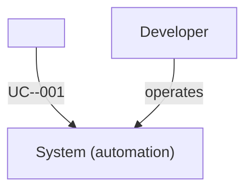

# Actors / Stakeholders (<Project>)

The **controlled vocabulary** for the `actor:` field in `use-cases.md`, and the map of who
interacts with the system. If roles (permission attributes) exist, define them in
`glossary.md` and keep in mind: **actor ⊋ role** — an actor is "who/what initiates a UC";
a role is a permission attribute a user holds. Users acting through a role are named by that
role; non-role actors (operations staff, batch/system, external AI clients, …) stand alone.

Each actor is declared as a **`### EnglishIdentifier`** heading under the `## Actor catalog`
section (the parser reads this scope). Structural sections (notation rules, relationship
diagram) stay at `##` and are not counted as actors, so the parser is language-independent.

## Actor catalog

### <User>

**<end user>** (<role/human>) | Main UCs: 001

<what they do in the system>

### Developer

**Developer** (operations) | Main UCs: 100–

Builds/operates the system (operational UCs).

### System

**System** (non-human)

Automated processing (policies, batches, webhooks).

> External systems (e.g. payment or VCS providers) are NOT actors — list them as External
> Systems in `domain-model.md`.

## Notation rules (`actor:` field)

- Use the **English identifier** from this catalog (canonical for code and i18n keys);
  localized labels are for display.
- Multiple actors are separated with `/` (e.g. `Owner / PM`).
- New actors must be registered here first as a `### EnglishIdentifier` heading (with the
  localized label in the body `**…**`) before use — `uneri-skills:udd-add` validates `actor:` against
  this catalog.

## Relationship diagram (optional)

